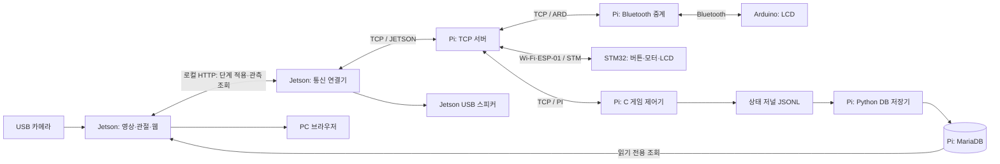

# 수업 코드에서 현재 무궁화 게임까지: Jetson·Raspberry Pi 코드 해설

작성일: 2026-10-12 · 독자: 수업 코드는 배웠지만 Codex와 개발한 현재 구조를 처음 다시 읽는 프로젝트 담당자

## 1. 이 문서의 비교 기준과 읽는 방법

비교 기준은 저장소 최초 커밋 `aeac262`(Initialize Pi and Jetson development baseline)와 현재 커밋 `1a3581a`이다. 현재 소스, Git 변경 이력, 실행·시험 기록을 대조했다. 이번 문서 작성에서는 원격 Pi/Jetson 접속, 게임 실행, 펌웨어 업로드, 새 성능 측정을 하지 않았다.

**최초 커밋을 수업 배포 원본과 완전히 같은 것으로 볼 수는 없다.** [저장소 기록](repository.md)에 따르면 Pi는 장치의 기존 `game` 폴더, Jetson은 기존 `python_tcp` 폴더를 가져왔다. 별도 `lecturecode`는 저장소에 없다. 최초 Pi 클라이언트에도 이미 `--lcd-demo`와 3초 간격 가상 COUNT 송신이 들어 있다. 따라서 아래의 “기준 코드”는 저장소에 확보된 수업 기반 코드이고, 수업 이후 모든 줄을 Codex가 처음 만들었다는 뜻은 아니다. 커밋 저자만으로 사람과 Codex의 기여를 줄 단위로 구분하지도 않는다.

문서는 다음 순서로 읽으면 된다.

1. 2~4장: 장치별 역할과 수업 코드 대비 변화 파악.
2. 5~7장: Pi 제어기, Jetson 영상, 통신을 실제 코드와 함께 이해.
3. 8~10장: 웹·DB·실행 환경 이해.
4. 11~14장: 개발 과정, 시험 근거, 한계, 직접 코드를 읽는 순서 확인.

본문의 링크는 저장소 안에서 해당 파일로 이동하도록 상대 경로로 작성했다. 기존 상세 문서는 당시의 중간 개발 상태를 포함하므로, 현재 동작 설명과 충돌하면 이 문서가 명시한 기준 커밋의 소스를 먼저 확인한다.

## 2. 현재 시스템은 무엇을 하는가

수업 예제에서 익힌 **소켓 접속·ID별 메시지 전달·카메라 읽기·YOLO 사람 검출**을 연결해, 실제 게임의 참가자·진행 순서·시간·결과를 관리하도록 확장했다.

| 구성 | 현재 책임 | 중심 파일 |
|---|---|---|
| Pi TCP 서버 | 로그인, 현재 접속 관리, 목적지별 메시지 전달 | [iot_server.c](../pi/server/iot_server.c) |
| Pi C 제어 클라이언트, ID `PI` | 참가자 확정, 게임 단계, 제한 시간, 모터 명령, 최종 통과/탈락, LCD 전송, 저장 저널 작성 | [iot_client.c](../pi/controller/iot_client.c), [game_state.h](../pi/controller/game_state.h), [cycle_trial.h](../pi/controller/cycle_trial.h) |
| Jetson 영상·웹 프로세스 | 카메라, YOLO 관절 검출·추적, 경기 구역/결승선, 움직임 후보, 화면 제공 | [web_server.py](../jetson/web_server.py), [game/](../jetson/game/) |
| Jetson 통신 연결기, ID `JETSON` | Pi 단계 명령을 영상 프로세스에 적용, 관측 후보 보고, 음원 재생 | [phase_test_client.py](../jetson/phase_test_client.py) |
| Pi DB 저장기 | C 제어기의 저널을 MariaDB에 순서대로 저장 | [game_db_writer.py](../pi/game_db_writer.py) |
| Pi Bluetooth 중계, ID `ARD` | TCP와 Arduino Bluetooth 사이 데이터 전달 | [bluetooth_client.c](../pi/bluetooth/bluetooth_client.c) |
| STM32, ID `STM` | START/STOP 버튼, 인형 회전, 회전 처리 완료 응답, LCD 표시 | [팀원 펌웨어](../stm32/game_controller/README.md) |
| Arduino | Pi가 보낸 인원·시간 표시, 적용 응답 | [팀원 스케치](../arduino/game_controller/game_controller.ino) |

**Pi 서버와 Pi 제어기는 같은 장치에서 실행되는 서로 다른 프로그램이다.** 서버가 게임 규칙을 판단하는 것이 아니라, 서버에 `PI`로 로그인한 C 클라이언트가 판단한다. Jetson도 영상 처리와 TCP 연결기를 별도 프로세스로 나누며, 연결기는 이미 계산된 결과를 읽기 때문에 모델을 두 번 실행하지 않는다.



장비 간 게임 메시지는 Pi 서버를 경유한다. 브라우저 조회와 Jetson 내부 HTTP, DB 연결, Bluetooth 구간은 별도 경로다.

## 3. 수업 기반 코드와 현재 코드의 차이 한눈에 보기

| 항목 | 최초 기준 코드 | 현재 코드 | 구분 |
|---|---|---|---|
| Pi 서버 | C 소켓·pthread·ID/비밀번호·목적지 중계 | 기본 구조 유지, 로그인/프레임 처리와 재접속 소유권 보완 | 기존 파일 수정 |
| Pi 클라이언트 | 송수신 스레드, 키보드 메시지, 수신 출력, LCD 데모 | 입력 검증·자동 게임 진행·타이머·판정·저장·장치 응답 감시 | 기존 파일 대폭 재구성 |
| Pi Bluetooth | TCP↔RFCOMM 중계 | 최초 기준과 소스 동일, 실제 게임에서도 중계 역할로 사용 | 보존·재사용 |
| Jetson TCP 예제 | 키보드 입출력 기반 Python 서버/클라이언트 | 예제 파일 보존, 별도 게임 연결기로 대체해 운용 | 원본 보존 + 새 파일 |
| Jetson 사람 검출 | `yolov8n.pt`, 웹캠, 프레임별 person 수 출력 | 검출+추적+관절 좌표+구역+결승선+정지 중 움직임 후보 | 새 처리 경로 |
| 화면 | Jetson `cv2.imshow()` 창 | PC 브라우저의 게임·진단·구역 설정 화면 | 추가 |
| 결과·시간 | 경기별 상태 관리 없음 | 시작 시 참가자 고정, 기본 180초, 결과 불변, 만료 처리 | 추가 |
| 장치 동기화 | 수동 문자열 교환 중심 | 모터 방향별 OK와 Jetson 실제 단계 적용 OK 확인 | 추가 |
| DB | 기준 저장소에 없음 | MariaDB 스키마·저널·저장기·웹 읽기 조회 | 추가 |
| 음원 | 기준 저장소에 없음 | 구호 완료 응답, 탈락 효과음 (웹 음량 조절은 롤백) | 추가 |
| 검증·운영 | 기준 저장소에 `tests/`, `deploy/` 없음 | 자동 시험, 진단 도구, 서비스 설정, 측정·문제 기록 | 추가 |

`jetson/examples/`의 세 예제와 `pi/bluetooth/`는 `aeac262..7c97106` 비교에서 변경이 없다. 현재 게임 전체가 옛 예제 파일 안에 구현된 것으로 찾으면 구조를 이해하기 어렵다. Jetson은 새 파일, Pi 제어기는 기존 이름의 재구성된 파일을 봐야 한다.

## 4. Jetson 수업 예제에서 출발한 부분

### 4.1 기존 person_count.py가 하던 일

[person_count.py](../jetson/examples/person_count.py)는 다음 흐름이다.

```text
YOLO('yolov8n.pt') 로드
→ VideoCapture(0)으로 프레임 읽기
→ model(frame)으로 물체 검출
→ 결과 클래스에서 person 개수 세기
→ 검출 박스와 인원수를 창에 출력
→ q 입력 시 종료
```

여기서 `person_id`는 모델의 사람 클래스 번호다. “참가자 1번”이나 특정 사람의 추적 ID가 아니다. 프레임에 2명이 보인다는 사실만으로 앞 프레임의 2명과 같은 사람인지 알 수 없고, 팔을 움직였는지도 알 수 없다.

### 4.2 기존 TCP 예제가 하던 일

[iot_client.py](../jetson/examples/iot_client.py)는 소켓에 접속하고 로그인 문자열을 보낸 뒤, 키보드 송신과 수신을 별도 스레드에서 처리한다. [iot_server.py](../jetson/examples/iot_server.py)는 한 연결을 받아 송수신하는 독립 학습 예제다.

현재 게임은 Jetson의 이 Python 서버를 실행하는 구조가 아니다. **Pi의 C 서버 한 곳을 통신 중심으로 사용**하고, Jetson은 `JETSON` 클라이언트로 접속한다. 기존의 소켓·로그인·문자열 송수신 개념을 유지하면서 참가자 등록·단계 적용·후보 보고를 자동화했다.

### 4.3 개발 중 추가된 실행 파일 구분

| 파일 | 추가 목적 | 현재 읽을 때의 위치 |
|---|---|---|
| [count_test_client.py](../jetson/count_test_client.py) | 카메라 없이 가상 COUNT 여섯 패턴으로 통신 경로 확인 | 통신 진단용 |
| [vision_client.py](../jetson/vision_client.py) | YOLO·ByteTrack 관측을 `VISION`/`POSITION`으로 Pi에 송신, 영상·구역 확인 | 초기 영상 연동·독립 진단용 |
| [realtime_video.py](../jetson/realtime_video.py) | 저장 영상을 원래 시간 흐름으로 재생하며 최신 검출 결과 표시 | 영상 재생 실험용 |
| [web_server.py](../jetson/web_server.py) | 추론·관절 후보·웹 화면을 묶어 제공 | 현재 게임의 영상 실행 진입점 |
| [phase_test_client.py](../jetson/phase_test_client.py) | Pi TCP 명령과 로컬 영상·웹을 연결 | 이름에 test가 있지만 현재 게임의 통신 실행 진입점 |

`count_test_client.py`, `vision_client.py`, `phase_test_client.py`를 같은 서버에 `JETSON`으로 동시에 로그인하면 세션이 교체될 수 있다. 현재 경기에서는 서비스로 실행되는 연결기를 기준으로 사용한다.

## 5. Pi 코드는 어떻게 확장됐는가

### 5.1 TCP 서버: 게임 규칙을 넣기보다 중계 기반을 보완

[pi/server/iot_server.c](../pi/server/iot_server.c)는 수업 코드의 C 소켓, `CLIENT_INFO`, `pthread`, mutex, ID 목록 파일, 목적지별 전송 구조를 유지한다. 현재도 `ALLMSG`, `IDLIST`, `GETTIME` 처리 경로가 남아 있다.

추가·변경된 핵심은 다음과 같다.

| 변경 | 코드에서 하는 일 | 필요한 이유 |
|---|---|---|
| 로그인 누적 수신 | `]`까지 바이트를 누적하고 형식·ID/비밀번호 검사 | TCP에서 로그인 문자열이 나누어 도착할 수 있음 |
| 로그인 제한 시간 | 초기 수신에 3초 제한 | 불완전한 로그인 연결에서 계속 대기하는 상황 제한 |
| 연결별 고정 fd | `CONNECTION`에 해당 연결의 fd를 별도 보관 | 재접속 후 예전 스레드가 새 소켓을 읽는 문제 방지 |
| 인증 후 동일 ID 교체 | 인증이 성공한 새 연결만 이전 연결을 shutdown | 틀린 비밀번호로 기존 정상 세션을 끊지 않게 함 |
| 소유권 확인 | 현재 등록 fd가 자기 fd일 때만 중계·등록 해제 | 옛 스레드 종료가 새 로그인 등록을 지우지 않게 함 |
| LF 단위 프레임 | 개행까지 누적, 여러 줄이면 각각 처리 | `read()` 한 번과 메시지 한 개가 같지 않음 |
| 과대·잘못된 입력 | NUL/길이 초과 메시지는 다음 개행까지 폐기 | 잘린 내용이 새 정상 명령으로 해석되는 것 방지 |
| 발신자 헤더 구성 | 목적지 헤더를 실제 로그인 ID로 바꿔 수신자에 전달 | MCU가 명령을 보낸 주체를 구분 |
| 목적지 형식 검사 | ID 길이·허용 문자 검사 | 잘못된 주소 처리 제한 |

주의할 범위: 현재 서버의 `send_msg()`는 여전히 여러 경로에서 `write()` 한 번을 호출하며, 반환된 송신 바이트를 끝까지 반복하는 함수가 없다. Pi 제어기의 `send_all()` 및 Jetson의 `sendall()`과 다르다. 일부 기존 기록의 “부분 송신 보완”을 서버의 모든 송신 경로가 보장된다는 뜻으로 읽으면 안 된다. `GETTIME`의 `sleep(1)` 같은 수업용 코드도 남아 있다. 이번에는 소스 확인만 했고 기능 수정이나 송신 실패 재현은 하지 않았다.

### 5.2 Pi 제어기: 수동 입출력 클라이언트에서 게임의 결정자로 변경

최초 [iot_client.c](../pi/controller/iot_client.c)는 `send_msg()`/`recv_msg()` 스레드로 키보드 입력을 보내고 받은 내용을 출력했다. 현재는 일반 채팅 클라이언트가 아니라 **PI 전용 제어기**다.

현재 구조는 `main()`의 `select()` 반복문이 소켓과 선택적 표준입력을 확인하고, 약 0.1초 간격으로 상태·타이머를 점검하는 방식이다. 표준입력이 닫히면 키보드 감시를 끄고 소켓 처리는 계속한다. 수신 데이터는 개행까지 누적한 뒤 `handle_line()`로 전달한다.

| 파일·함수 | 실제 책임 |
|---|---|
| `iot_client.c / main()` | 실행 인자 검사, PI 로그인, 수신 버퍼, 입력·주기 처리 |
| `iot_client.c / send_all()` | EINTR와 부분 송신을 처리하며 전체 문자열 전송, 명령 감시 등록 |
| `iot_client.c / parse_counts()` | 숫자 3개·0~99·통과+탈락≤전체 검증 |
| `iot_client.c / observation()` | 초기 VISION/POSITION 형식 검사, VISION_ACK 반환 |
| `iot_client.c / handle_line()` | 발신자와 명령을 구분해 게임·시험·ACK 처리로 분기 |
| [cycle_trial.h](../pi/controller/cycle_trial.h) | 모터 방향, Jetson 적용 확인, 회차·복귀·하트비트 상태 |
| [game_state.h](../pi/controller/game_state.h) | 참가자, 경기 ID, 제한 시간, 판정, 음원 요청, LCD, 저널 |
| [command_status.h](../pi/controller/command_status.h) | 보드별 COUNT/TIME/MOTOR 예상 ACK와 웹 표시 상태 |

현재 `.h` 파일에는 선언뿐 아니라 `static` 함수와 상태 변수도 들어 있다. `iot_client.c`가 `cycle_trial.h`를 포함하고, 그 안에서 `game_state.h`를 포함한다. 별도 프로그램 세 개가 아니라 함께 컴파일되는 C 제어기 하나다. Makefile은 이 헤더가 바뀌어도 다시 빌드하며, 시간 계산에 쓰는 수학 함수를 위해 `-lm`을 추가했다.

### 5.3 참가자 등록과 최종 판정

START 시점에 Jetson이 구역 안의 고유 추적 ID 목록을 보내면 Pi가 그 목록을 경기 참가자로 고정한다. 등록 요청 토큰, 목록 크기, 중복 ID, 끝 메시지를 검사하고 3초 안에 등록을 마치도록 한다. 최대 32명이며 0명은 시작하지 않는다.

예를 들어 시작할 때 추적 ID `7`, `12`가 있으면, 이 경기의 참가자 1·2번을 그 ID에 대응시킨다. 나중에 ID `19`가 들어와도 참가자가 추가되지 않는다. `12`가 가려졌다가 `25`로 검출돼도 같은 사람이라고 자동 연결하지 않는다. 얼굴 인증이나 사람 재식별 기능은 없다.

Pi는 `OBS` 후보를 받을 때 다음을 모두 검사한다.

- 현재 경기가 진행 중인가, 경기 ID가 같은가.
- 현재 단계 요청 토큰이 같은가.
- 입력 반복 세대 `epoch`와 구역 설정 버전이 등록 당시와 같은가.
- 등록한 추적 ID인가, 아직 `playing` 상태인가.
- 현재 단계에서 그 종류의 판정을 허용하는가, 제한 시간이 지나지 않았는가.

통과 또는 탈락이 확정되면 그 참가자의 상태는 해당 경기에서 다시 바뀌지 않는다. 같은 OBS가 여러 번 와도 인원수와 이벤트가 반복 증가하지 않는다. 기존 통신 시험 COUNT도 `--game`의 확정 집계를 덮어쓰지 못한다.

### 5.4 제한 시간과 종료

기본 제한 시간은 180초이며 참가자 확정 직후부터 계산한다. `CLOCK_MONOTONIC`으로 종료 시각을 정하므로 시스템 시계 변경에 따라 경기 시간이 흔들리는 것을 피한다. 남은 시간은 `ceil(종료시각-현재시각)`이며 모터와 통신 응답 대기도 제한 시간에 포함한다.

| 상황 | 현재 처리 |
|---|---|
| 전원 통과 또는 탈락 | `finished`, 사유 `all_resolved` |
| 제한 시간 만료 | 미완료 참가자 모두 탈락, 남은 시간 0, `finished/timeout` |
| STM STOP·운영자 stop | `aborted/operator_stop`, 미완료를 통과나 탈락으로 꾸미지 않음 |
| 통신/하트비트 문제 | `aborted/communication_error` 등 사유 기록, 복귀 시도 |
| 음원 실패·완료 응답 제한 초과 | `audio_error` 또는 `audio_timeout`으로 중단 |
| 입력/구역 설정 버전 변경 | `source_changed`로 중단 |
| 제어기에서 연결 종료 감지 | 가능한 경우 `controller_disconnected` 종료 저널 기록 |

SIGINT/SIGTERM 정상 종료 경로는 중단 기록과 뒤보기 요청을 수행한다. 요청을 보냈다는 사실과 물리 복귀 응답까지 받은 사실은 다르다. SIGKILL·전원 차단은 이 종료 기록을 보장하지 않는다. 현재 C 제어기 자체에는 서버 자동 재접속 반복이나 systemd 자동 재기동이 구현돼 있지 않다.

### 5.5 장치 응답 감시

`command_status.h`는 ARD/STM 각각의 COUNT/TIME/MOTOR에 대해 기대 응답을 보관한다. COUNT/TIME은 `APPLIED@...`, MOTOR는 같은 방향의 `...@OK`가 일치해야 완료다.

웹에 보이는 상태는 `NONE`(미송신), `WAIT`(응답 대기), `TIMEOUT`(미완료 10초 경과), `DONE`(일치 응답 완료)이다. 완료 후 오래 조용하다는 이유로 다시 TIMEOUT으로 바꾸지 않는다. 이것은 표시용 감시다. 게임 진행을 결정하는 모터·단계 상태 머신 및 완료 제한과 구분해야 한다.

### 5.6 Bluetooth는 무엇이 바뀌었는가

[Pi Bluetooth 소스](../pi/bluetooth/bluetooth_client.c)는 최초 커밋과 같다. TCP 서버에 `ARD`로 로그인하고 Arduino와 RFCOMM 연결을 맺어 양방향 데이터를 전달하는 수업 기반 구조를 재사용했다. 게임 판정과 타이머를 Bluetooth 중계에 추가한 것은 아니다.

변화는 중계 위로 흐르는 데이터와 Arduino 쪽 처리에 있다. 기존 진단 문자열뿐 아니라 Pi가 정한 `COUNT`와 `TIME`을 전달하고 Arduino의 `APPLIED` 응답을 Pi로 돌려보낸다. 따라서 웹의 “ARD 서버 접속”은 우선 중계 프로세스의 TCP 접속을 뜻하며, Arduino가 명령을 실제 적용했다는 근거는 별도 ACK다.

## 6. Jetson 영상 코드는 어떻게 확장됐는가

### 6.1 현재 영상 한 프레임의 처리 순서

`web_server.py / run_vision()`에서 핵심 흐름을 볼 수 있다.

```text
FrameSource로 입력 열기 → 모델 로드·준비 추론
→ 캡처 스레드가 최신 프레임 한 칸에 게시
→ 추론 스레드가 model.track(..., persist=True, tracker='bytetrack.yaml') 실행
→ 사람 박스·추적 ID·관절 좌표 추출
→ 구역 안팎·결승선 통과 후보 계산
→ 박스 움직임 진단 + 관절 고정 기준 자세 비교
→ 시험 기록 중이면 좌표·원본 프레임을 기록기에 전달
→ 정해진 주기에 화면 JPEG 생성
→ Monitor에 최신 결과 저장 → 브라우저와 TCP 연결기가 조회
```

서비스 설정은 `.runtime/pose-models/yolov8n-pose-480x640-fp16.engine`을 지정한다. `web_server.py`를 모델 옵션 없이 직접 실행할 때의 기본값은 사람 검출 `.pt`이므로, 그 자체가 현재 관절 경기 실행 조건과 같지는 않다. 파일명·실행 인자를 함께 봐야 한다.

### 6.2 입력 공통화와 최신 프레임 처리

[source.py](../jetson/game/source.py)는 카메라와 저장 영상을 같은 `FrameSource` 인터페이스로 읽는다. 웹캠은 640×480과 버퍼 1을 요청하며, 실제 입력 크기는 읽은 프레임으로 확인한다. 저장 영상은 파일 존재·FPS를 검사하고 영상 시각을 사용한다. 반복 재생 때 `epoch`를 증가시킨다.

[realtime.py](../jetson/game/realtime.py)의 `LatestFrame`은 프레임을 계속 쌓는 대기열이 아니라 **가장 최근 프레임 한 개**를 보관한다. 추론이 느릴 때 오래된 프레임 전체를 순서대로 처리하면 현재 상황과 화면이 멀어진다. 최신 방식은 중간 프레임 일부를 건너뛰어 이 누적 지연을 줄인다. 따라서 모든 원본 프레임을 분석한다는 보장은 없다. 원본 전체 순차 분석과 실시간 관측은 목적이 다르다.

카메라의 모델 준비 이전 첫 프레임을 준비 후 오래된 상태로 보내지 않도록 새 프레임부터 시작하는 처리도 추가됐다. 저장 영상의 재생 시간 제어, 입력 반복 시 추적 상태 초기화, 입력 실패 후 영상 처리 재시도 역시 원래의 단순 `cap.read()` 반복에서 확장된 부분이다.

### 6.3 검출과 추적, 관절은 각각 무엇인가

| 결과 | 코드에서 얻는 값 | 의미 |
|---|---|---|
| 사람 검출 | `boxes.xyxy`, `boxes.conf` | 현재 프레임의 사람 위치와 검출 신뢰도 |
| ByteTrack 추적 | `boxes.id` | 프레임 사이 같은 대상으로 연결한 임시 번호 |
| Pose 관절 | `keypoints`의 17개 `(x,y,confidence)` | 코·눈·귀·어깨·팔꿈치·손목·골반·무릎·발목 위치 |
| 게임 참가자 | Pi가 고정한 추적 ID 목록 | 이번 경기에서 결과를 관리하는 대상 |

현재 게임은 `classes=[0]`, 검출 신뢰도 0.35로 사람을 대상으로 추적한다. [detector.py](../jetson/game/detector.py)는 `.pt`와 `.engine`을 공통 로드하고, 관절 모델 결과가 박스마다 17×3 구조인지 검사한다. 사람이 0명인데 라이브러리가 빈 관절 배치를 특이한 형태로 반환하는 경우는 빈 목록으로 정규화한다.

### 6.4 경기 구역과 결승선 설정

[geometry.py](../jetson/game/geometry.py)는 좌표를 화면 폭·높이에 대한 0~1 비율로 다룬다. 박스 아래쪽 중심 `(박스 x중심, 박스 y최댓값)`을 사람의 발 위치를 대신하는 점으로 사용한다. 실제 발목 관절을 ROI 위치 기준으로 사용하는 구조는 아니다.

구역 ROI는 3~32개의 점으로 이루어진 다각형이다. 결승선은 서로 다른 두 점이며, 추가로 “어느 쪽이 도착 방향인가”를 지정하는 점을 둔다. 중복 점·면적 없는 구역·자기 교차·잘못된 좌표·결승선 위의 방향 점을 거부한다. 기준 영상과 가로세로 비율이 약 1% 넘게 달라지면 재설정을 요구한다.

[calibration_store.py](../jetson/game/calibration_store.py)는 설정 버전을 검사해 여러 화면에서 동시에 저장한 값의 덮어쓰기를 막고, 임시 파일·fsync·교체로 설정을 저장한다. 설정 변경은 추적·결승선·진단 상태 재설정에 반영된다. 경기 중 변경을 감지하면 연결기가 Pi에 오류를 보고한다.

### 6.5 결승선 통과 후보

[finish.py](../jetson/game/finish.py)의 `FinishDetector`는 선 주변에 있다는 이유만으로 통과시키지 않는다.

1. 구역 안에서 출발 쪽에 있던 추적 ID가 준비 상태가 된다.
2. 이전 발 위치와 현재 발 위치가 지정 방향으로 선을 가로지르는지 검사한다.
3. 결승선의 무한 연장선이 아니라 실제 두 끝점 사이를 지났는지 검사한다.
4. 구역 내부 교차인지, 도착 쪽으로 여유 거리만큼 진행했는지 확인한다.
5. 관측 간격이 0.5초를 넘으면 이전 연결을 그대로 믿지 않는다.
6. 같은 ID의 완료 후보를 중복 생성하지 않는다.

여유 거리는 정규화 좌표 기준 0.01이다. 이 계산은 Jetson의 **통과 후보**다. 실제 게임에서는 이동 단계의 통과 후보를 PASS로, 정지 단계의 결승선 통과를 FAIL로 보고하며 최종 적용은 Pi가 한다.

### 6.6 박스 이동에서 관절 비교로 발전

[motion.py](../jetson/game/motion.py)는 박스 중심 이동량으로 움직임을 진단하던 코드다. 박스 높이에 대해 이동량을 정규화하고 짧은 관측 창, 정지 유예, 지속 조건을 적용한다. 사람이 제자리에서 팔만 움직이면 박스 중심 변화가 작거나 박스가 흔들릴 수 있어 실제 움직임과 잘 대응하지 않는 한계가 기록됐다.

현재 경기 후보는 [pose_motion.py](../jetson/game/pose_motion.py)의 `PoseMotionTrial` 결과를 사용한다. 박스 진단 코드는 비교·진단 용도로 함께 남아 있으며, 현재 판정 실패 시 자동으로 박스 방식에 의존하는 대체 경로는 아니다.

관절 방식은 STOP 요청 이후 첫 적용 프레임의 자세를 **고정 기준**으로 잡고 같은 ID의 현재 관절과 비교한다. 매 프레임 직전 자세로 기준을 계속 바꾸지 않으므로 천천히 누적되는 움직임도 비교할 수 있다. STOP 명령보다 먼저 캡처된 프레임은 새 기준으로 사용하지 않는다.

| 현재 코드의 조건 | 값·처리 | 의미 |
|---|---|---|
| 비교 관절 | 어깨~발목 12개, COCO index 5~16 | 얼굴 관절은 움직임 계산에서 제외 |
| 관절 신뢰도 | 0.5 이상 | 불확실한 좌표 제외 |
| 유효 자세 | 비교 관절 4개 이상, 어깨/골반 2개 이상 | 최소 몸통 근거 확보 |
| 거리 보정 | 기준 프레임의 박스 높이로 나눔 | 화면에서 큰 사람과 작은 사람의 비교 기준 조정 |
| 손목 조건 | 한 손목 이동이 기준 높이의 3% 이상 | 제자리 팔 움직임 포착 |
| 손목 외 몸 관절 | 두 관절이 각각 3% 이상 | 한 관절만 흔들린 결과 완화 |
| 후보 확정 | 조건이 0.2초 이상, 3관측 이상 지속 | 한 프레임 잡음을 즉시 탈락 후보로 만들지 않음 |
| 별도 정지 유예 | 0초 | 옛 박스 방식의 0.7초와 다름 |
| 추적 단절 | 0.5초 초과 등에서 판정 보류 | 가려졌다 나타난 좌표를 무리하게 비교하지 않음 |

예를 들어 기준 박스 높이가 200픽셀이면 3%는 6픽셀이다. 이는 구현을 이해하기 위한 계산 예시이며 검출 정확도나 사람이 실제 움직인 거리 6픽셀을 완벽하게 판별한다는 보장은 아니다. 신뢰도·관절 개수·지속 조건도 함께 충족해야 한다.

구역 밖, 이미 결승선 후보가 된 대상, 불충분한 관절, 추적 공백 등은 `hold`와 이유로 표시한다. 관절이 보이지 않는 것을 자동으로 “움직임 없음”으로 확정하지 않는다. 기준 자세가 없거나 추적이 끊긴 참가자의 판정 공백은 남아 있는 한계다.

### 6.7 TensorRT 엔진 지원과 성능 개선

수업 예제의 PyTorch `.pt` 실행 외에 TensorRT `.engine`을 선택할 수 있게 했다. [build_engine.py](../jetson/build_engine.py)는 고정 크기 ONNX 내보내기와 Jetson TensorRT 8 엔진 생성을 나누고, FP16 옵션·입력 크기·작업 공간·메타데이터를 관리한다. 엔진은 입력 모양이 고정되므로 로더가 파일의 메타데이터에서 크기를 읽어 적용한다.

또한 오래된 TensorRT와 NumPy의 `np.bool` 호환 처리, detect/pose 작업 종류 확인, 기존 엔진 파일 덮어쓰기 방지, 실행 중 라이브러리 자동 설치 차단을 추가했다. 모델·엔진 바이너리는 Git에 포함하지 않는다.

역사적 비교 수치는 아래 범위에서만 의미가 있다. 근거와 측정 산출물 위치는 [엔진 최적화 기록](jetson-engine-optimization.md)을 참고한다.

| 저장 영상 사람 검출 비교 | PyTorch FP32 | TensorRT FP16 |
|---|---:|---:|
| 처리량 | 12.76 FPS | 18.53 FPS |
| 프레임 처리 평균 | 78.37 ms | 53.97 ms |
| 프레임 처리 p95 | 85.67 ms | 56.44 ms |
| 사람 검출 프레임 | 594/598 | 594/598 |

조건: 동일 960×540 저장 영상 598프레임, YOLOv8n 사람 검출, 실제 텐서 1×3×384×640, 신뢰도 0.35·ByteTrack, 5프레임 준비 뒤 순차 실행. 처리 시간에는 입력 읽기·검출/추적·기하 계산이 포함되며 화면 출력·파일 저장·Pi 통신은 제외했다. 정답 주석에 대한 정확도는 측정하지 않았다. PyTorch 대비 FP16 박스 IoU 평균 0.993876/최소 0.934298은 출력 일치도다.

이 조건의 처리량은 약 1.45배지만 **현재 관절 게임 전체의 FPS, 정확도, 카메라부터 LCD까지 반응 지연의 개선 배수는 아니다.** 최신 프레임 처리와 미리보기 간격 분리 역시 별도 변경이며 위 배수에 모두 합산된 효과라고 말할 수 없다.

## 7. 한 경기가 실제로 진행되는 순서

### 7.1 먼저 알아둘 메시지 규칙

서버에 보낼 때 대괄호는 목적지다. 서버가 전달한 뒤에는 대괄호가 실제 발신자다.

```text
Pi가 서버에 송신:   [STM]MOTOR@FRONT\n
STM이 최종 수신:    [PI]MOTOR@FRONT\n
STM이 서버에 응답:  [PI]MOTOR@FRONT@OK\n
Pi가 최종 수신:     [STM]MOTOR@FRONT@OK\n
```

`@`는 필드 구분자, `\n`은 실제 LF 문자다. 로그인 `[ID:비밀번호]`는 닫는 대괄호까지, 일반 게임 메시지는 LF까지 누적한다. 일반 경로는 100바이트 안에 맞춘 짧은 ASCII 메시지를 사용한다. 아래 예시의 `<...>`는 자리 표시이며 그대로 보내는 값이 아니다.

### 7.2 준비와 시작

1. Pi 서버, Bluetooth 중계, Jetson 웹·연결기, Pi 게임 제어기를 실행한다.
2. Pi는 STM에 REAR, Jetson에 IDLE을 요청한다. 두 응답을 확인해야 `HOME`이 되어 시작 잠금이 풀린다.
3. Jetson 연결기는 추론 상태·관절 사용 여부·관측의 신선도·Pi 하트비트를 확인한다. 준비되지 않으면 시작하지 않는다.
4. 사람이 경기 구역 안에 선 후 STM START를 누른다. Pi는 JOIN 토큰으로 등록을 요청한다.
5. Jetson은 `JOIN_BEGIN`, 참가자별 `JOIN_PERSON`, `JOIN_END`로 목록과 epoch·설정 버전을 보고한다.
6. Pi는 참가자를 고정하고 무작위 32자리 hex 경기 ID를 만든다. 제한 시간 계산·저널 기록·COUNT/TIME 송신을 시작한다.
7. Pi는 Jetson에 `GAME@<경기ID>@<epoch>@<설정버전>` 및 `PHASE@MOVE@<토큰>`을 보낸다.
8. 연결기는 로컬 웹에 MOVE를 요청하고 실제 새 추론 결과에 그 단계 버전이 반영된 것을 확인한 후 Pi에 OK를 보낸다.

### 7.3 구호, 앞보기, 정지 판정, 뒤보기의 반복

```text
Jetson MOVE 적용 OK
→ Pi가 0.5~2초 랜덤 대기
→ Pi가 AUDIO CHANT 요청
→ Jetson 스피커 구호 재생
→ 재생 프로세스 종료 후 Jetson AUDIO DONE
→ Pi가 STM MOTOR FRONT 요청
→ STM FRONT OK
→ Pi가 랜덤 정지 유지 종료 시각 설정(기본 2~5초), Jetson STOP 요청
→ Jetson 새 추론에서 STOP 적용 확인, PHASE STOP OK
→ Pi HOLD: 현재 단계의 FAIL 후보만 최종 적용
→ 정지 유지 시간이 끝나면 STM MOTOR REAR 요청
→ STM REAR OK
→ Jetson MOVE 적용 OK
→ 다음 구호 단계 반복
```

앞보기 회전 중에는 Pi가 PASS를 허용한다. STOP 적용 대기 동안은 결과 반영 단계가 아직 아니며, Pi가 STOP OK를 받고 HOLD에 들어간 뒤 FAIL을 허용한다. 뒤보기 완료를 기다리는 동안도 FAIL을 허용하며, MOVE 적용 확인 뒤 이동 단계로 돌아간다. 이처럼 회전 명령 송신, 보드 OK, Jetson 적용 OK, Pi의 판정 허용 상태를 구별해야 한다.

정지 유지 타이머는 STM FRONT OK 수신부터 시작한다. Jetson STOP 적용 시간이 그 안에 포함되므로 “Jetson에서 판정 가능한 시간이 항상 정확히 2~5초”라고 해석하면 안 된다. 전체 지연과 단계 경계 공정성은 별도 현장 검증 대상이다.

음원 사용을 끈 고급/진단 실행에서는 이동 창 기본 5초가 구호를 대신한다. 현재 간단 실행은 음원을 기본으로 켠다. 기존 문서의 “현재 음원 대신 5초”는 이력이거나 음원 비활성 조건을 설명한다.

### 7.4 Jetson 후보와 Pi 확정의 차이

[game_bridge.py](../jetson/game/game_bridge.py)는 단계·버전이 현재 기대값과 같은 영상 결과에서 후보를 고른다. 연결기는 대략 0.2초 주기로 결과를 확인해 다음 형식으로 송신한다.

```text
[PI]OBS@<경기ID>@<단계토큰>@<추적ID>@PASS@<epoch>@<설정버전>\n
[PI]OBS@<경기ID>@<단계토큰>@<추적ID>@FAIL@<epoch>@<설정버전>\n
```

이동 중 결승선 후보는 PASS, 정지 중 결승선 후보 또는 관절 움직임 후보는 FAIL이다. 이전 단계에서 생성된 후보에는 단계 버전이 붙어 있어 다음 단계 후보로 재사용하지 않는다. Pi는 추가 검증을 통과한 후보만 확정한다.

### 7.5 중단과 복귀

STOP·오류·정상 종료 후에는 Jetson IDLE과 STM REAR 복귀를 요청한다. 두 응답이 확인되기 전에는 START를 허용하지 않는다. 일반 완료 제한은 기본 10초이고, 복귀가 확인되지 않으면 오류를 표시하며 5초 뒤 재시도한다. START를 미리 예약해 복귀 순간 자동 시작하지는 않는다.

Jetson 연결기는 재접속 시 이전 게임의 메모리 상태를 복원한 것으로 간주하지 않고 `TRIAL@ERROR`를 보내 기존 경기를 중단시킨다. “연결은 금방 돌아왔으므로 예전 경기 계속 진행”으로 처리하지 않는 이유는 현재 단계·경기 연결 정보가 사라졌기 때문이다.

모터 완료 메시지는 방향으로 구분하지만 경기 ID나 회전 요청 번호가 없다. 따라서 매우 늦게 온 예전의 같은 방향 OK를 모든 조건에서 구별하는 보장은 없다. STM 현재 구현의 OK는 각도 센서 실측이 아니라 펌웨어 회전 처리·대기 기준이라는 한계도 있다.

## 8. 웹 화면과 사운드에 추가된 것

### 8.1 웹은 영상 출력 창에서 운영 화면으로 확장

[web.py](../jetson/game/web.py)의 `ThreadingHTTPServer`와 `Monitor`가 HTTP·최신 상태·영상 캐시를 제공하고, [web/](../jetson/web/)의 HTML/CSS/JavaScript가 화면을 구성한다. 각 브라우저가 YOLO를 따로 실행하지 않고 같은 결과와 JPEG를 공유한다.

| 화면·경로 | 주요 기능 |
|---|---|
| `/` | 게임 영상, 남은 시간, 전체/통과/탈락, 참가자 결과, 장치 상태, 음량 |
| `/debug` | 추적 ID, 후보, 움직임·관절 진단, 회차 상태, 시험·기록 도구 |
| `/calibrate` | 현재 카메라에서 구역·결승선·도착 방향 설정 |
| `/api/vision` | 최신 검출·관절·후보·처리 시간·관측 나이 |
| `/api/game` | DB의 최근 경기·참가자·이벤트 조회 |
| `/api/cycle` | Pi 회차 상태·모터 응답·건강 상태·적용 단계 |
| `/api/connections` | 서버 IDLIST에서 얻은 실제 TCP 접속 목록 |
| `/api/commands` | Pi가 감시하는 보드 명령 완료 상태 |
| `/game-stream.mjpg`, `/stream.mjpg` | 게임용·진단용 연속 JPEG 미리보기 |

게임 영상은 박스·관절·구역을 보여주되 임시 추적 ID 같은 디버그 문구를 줄인다. 진단 스트림에는 ID와 판정 상태를 남겼다. 웹 영상 비율은 실제 입력 크기를 따른다. 영상 지연·입력 오류·DB 조회 실패·오래된 경기 기록을 화면에 구분해 표시한다.

**서로 다른 속도:** 기본 미리보기 상한은 5FPS, 추론은 처리 가능한 속도, 연결기의 후보 조회는 약 5Hz, 게임 DB 화면 조회는 2초, 영상 상태 조회는 1초다. 미리보기 FPS만 보고 전체 판정 속도를 판단할 수 없다.

### 8.2 접속과 응답을 분리한 이유

이전 DB의 `last_seen_at`은 마지막 수신 기록이므로 오래 조용한 장치를 지금 끊긴 것으로 오해할 수 있었다. 현재는 연결기가 2초마다 IDLIST를 조회해 접속 목록을 갱신하고, 6초 넘게 갱신되지 않으면 “조회 지연”으로 표시한다. 명령 처리는 Pi의 정확한 예상 ACK 일치 여부로 별도 표시한다.

즉 “서버 접속 중”, “마지막 명령 처리 완료”, “과거 DB 수신 기록”은 서로 다른 정보다. ARD 접속 표시가 Arduino 전원·Bluetooth·LCD의 정상 동작을 모두 보장하지 않는다.

### 8.3 표시 초기화와 실제 데이터

게임 화면의 초기화는 종료/중단된 최근 경기 ID를 브라우저 `localStorage`에 기억해 그 경기 표시를 숨기는 동작이다. DB 삭제, MCU RESET, 새 경기 START가 아니다. 새 경기 ID가 들어오면 다시 표시한다. 영상 진단 초기화 `/api/validation/reset`도 추론의 시험 상태를 초기화하는 별도 기능이다.

경기 중 진단 단계 버튼과 구역 설정 진입을 화면에서 제한하지만, 최종 검증은 연결기의 단계/버전 검사와 Pi가 맡는다. 웹 API는 JSON·지정 헤더·Origin 등을 검사하고, 연결기 상태 갱신용 API는 로컬 접속으로 제한한다. 이것이 별도 사용자 계정 로그인 시스템을 구현한 것은 아니다.

### 8.4 구호·효과음·음량

[audio.py](../jetson/game/audio.py)는 `ffplay`를 비동기 프로세스로 실행해 구호 재생 중에도 통신을 처리한다. 구호 종료 코드를 확인해 DONE/ERROR를 Pi에 보고한다. 음원 파일은 `.runtime/audio/chant.mp3`, `shot.mp3`이며 Git에 넣지 않는다.

탈락 효과음은 Pi가 새로 확정한 참가자마다 요청한다. 중복 키로 같은 효과음 요청의 재생을 막고, 여러 명 동시 탈락은 0.25초 간격으로 시작한다. 앞 소리의 종료를 기다리는 방식이 아니라 잔향이 겹칠 수 있다. 실제 Jetson 부하와 청감은 별도 확인 대상이다.

웹 음량·음소거 조절은 `7c97106`에서 시도했으나 사용자 요청으로 `a4efaf4`에서 제거했다. 현재는 기존 USB 스피커 출력 설정을 사용하며 해당 API·설정 저장·웹 제어 파일을 제공하지 않는다. 롤백 검증은 `1a3581a`와 트러블슈팅 기록을 참고한다.

## 9. DB와 시험 기록은 어떻게 추가됐는가

### 9.1 C 제어기와 DB 사이에 저널을 둔 구조

```text
Pi C에서 상태 확정
→ .runtime/game/events.jsonl에 JSON 한 줄 추가·fflush·fsync
→ 별도 Python 저장기가 읽음
→ MariaDB 트랜잭션으로 경기·참가자·이벤트 반영
→ 성공한 파일 오프셋 저장
→ Jetson이 읽기 전용 DB 계정으로 조회
```

C 코드에 DB 접속·인증·재접속 로직을 직접 넣는 대신 저장 전용 Python 프로세스를 분리했다. DB 장애 시 저장기가 저널을 보존하고 재시도하므로 게임 판단 코드와 DB 재접속을 분리할 수 있다. 다만 C의 디스크 fsync와 TCP 송신은 동기 호출이므로 모든 장애에서 게임 루프 지연이 없는 구조는 아니다.

[game_db_writer.py](../pi/game_db_writer.py)는 파일 잠금으로 저장기 중복 실행을 막고, DB 트랜잭션 커밋 뒤에만 `.offset`을 갱신한다. DB 저장 후 오프셋 기록 전에 중단돼 같은 줄을 다시 읽어도 경기별 `state_version`과 고유 `event_key`로 중복·과거 상태 역전을 막는다. 저널이 임의로 잘렸는데 오프셋이 더 크면 조용히 처음부터 진행하지 않고 오류로 중단한다.

로컬 저널 기록 자체가 실패하면 C 제어기는 계속 저장된 것처럼 진행하지 않는다. DB 오류 로그에는 비밀값이나 SQL 전체 대신 오류 코드를 남긴다.

### 9.2 추가된 테이블

| 테이블 | 저장 내용 | 사용 목적 |
|---|---|---|
| `games` | 경기 ID, 단계, 시작·갱신·종료 시각, 남은 시간, 제한 시간, 종료 사유, 상태 버전 | 최근 경기와 종료 이력 |
| `participants` | 경기별 P01… 번호, 추적 ID, 입력 epoch, playing/passed/failed | 고정 참가자와 결과 |
| `events` | 단계·결과·종료 사건, 참가자, 고유 이벤트 키 | 결과 변화의 근거 |
| `device_status` | 장치별 마지막 수신·ACK 등 | 과거 수신 기록 |

스키마는 [001_schema.sql](../database/001_schema.sql)과 [002_game_state.sql](../database/002_game_state.sql)에 있다. 매초 남은 상태는 저장하지만 `tick`과 `device_ack`를 경기 이벤트 목록에 계속 추가하지는 않는다. 웹은 최근 경기와 최근 이벤트 최대 30개를 조회하며, 현재 모든 과거 경기를 검색하는 완성된 이력 관리 화면이 있는 것은 아니다.

[mariadb_store.py](../jetson/game/mariadb_store.py)는 읽기 전용 일관된 스냅샷으로 여러 테이블을 조회하고 연결을 닫는다. 웹 코드에는 SQLite 읽기 어댑터도 있어 시험·대체 입력에 사용할 수 있지만, 배포 서비스는 MariaDB 설정 파일을 지정한다. 실제 인증 JSON·DB·저널은 `.runtime/`에 있어 Git에서 제외한다.

### 9.3 관절 시험 기록

[recording.py](../jetson/game/recording.py)의 `TrialRecorder`는 경기 결과 DB와 별도다. 정지·팔 움직임·회전·거리·교차 등 시나리오에서 **추론한 시점의 원본 프레임**, 박스·관절·ID·설정·시각·후보를 남겨 나중에 분석할 수 있게 했다.

기록은 미리보기 5FPS가 아니라 추론 결과 주기에 맞춰 제출한다. 카메라의 모든 원본 프레임을 저장한다는 뜻은 아니다. 비동기 큐 상한 16, 기본 120초, 최대 6000샘플, 이미지 크기 상한 약 512MiB, 시작 시 여유 공간 1GiB 검사를 둔다. 큐가 밀리면 누락 수를 기록한다. 결과는 `.runtime/pose-recordings/` 아래 `metadata.json`, `samples.jsonl`, `frames/`, `summary.json`에 남는다.

[analyze_pose_recording.py](../jetson/analyze_pose_recording.py)로 기록을 분석한다. 사용자 영상·원본 이미지·좌표 기록은 Git에 넣지 않는다. 기록량과 검출 횟수는 정답 주석 기반 움직임 정확도와 구분한다. 상세 기록은 [관절 기록](pose-recording.md), [시험 결과](pose-trial-results-20261007.md), [관절 판정 실험](pose-motion-trial.md)에 있다.

## 10. 실제 사용하는 파일과 실행 방법

### 10.1 일반 경기 실행

Pi 저장소 루트에서 최초 또는 소스 변경 후 빌드한다. 서버 로그인 설정과 Bluetooth 연결 환경은 [Pi 설치](setup-pi.md)를 따른다.

```bash
make -C pi/server
make -C pi/controller
make -C pi/bluetooth
```

Pi 서버는 `idpasswd.txt`가 있는 `pi/server` 디렉터리에서 `./iot_server 5000`으로 실행한다. Bluetooth 중계도 별도로 실행되어 있어야 한다. 중계의 연결 대상 MAC은 기존 코드에 고정되어 있다.

서버·중계가 준비되고 같은 ID의 제어기가 중복 실행되지 않는 상태에서 다음 중 하나를 사용한다.

```bash
# 기본 180초, 구호·효과음 사용
./pi/controller/iot_client

# 20초 단축 경기, 구호·효과음 사용
./pi/controller/iot_client 20

# 백그라운드로 180초 대기
python3 tools/start_pi_game.py

# 백그라운드로 20초 대기
python3 tools/start_pi_game.py 20
```

실행만으로 경기가 START되지는 않는다. HOME을 확인하고 사람이 구역 안에 들어간 뒤 STM START를 누른다. 간단 실행은 시간 1~3600초를 허용한다. 고급 형식 `iot_client <IP> <port> PI --game ...`도 유지하며, **고급 형식에 `--audio`를 생략하면 음원을 사용하지 않는다.**

[start_pi_game.py](../tools/start_pi_game.py)는 `/proc`에서 기존 PI 제어기를 확인하고 FIFO·로그·PID 파일을 준비한다. 제어기 실행 보조 도구이며 서버·Bluetooth 전체를 자동 시작하거나 제어기를 계속 감시하는 서비스는 아니다.

백그라운드 경기의 운영자 중단은 다음과 같다. 이는 제어기 종료가 아니라 실행 중 제어기에 `stop` 입력을 전달한다.

```bash
printf 'stop\n' > .runtime/game/input
```

### 10.2 Jetson 서비스

[mugunghwa-web.service](../deploy/mugunghwa-web.service)는 관절 엔진·DB·구역 설정을 지정해 웹/추론을 실행한다. [mugunghwa-phase-bridge.service](../deploy/mugunghwa-phase-bridge.service)는 Pi 서버와 로컬 웹을 연결한다. 웹 서비스는 실패 시 재시작하고 연결기는 항상 재시작하도록 설정됐다. 파일은 서비스 정의이며 이번 문서 작성에서 장치에 설치·실행 중인지 새로 확인한 것은 아니다.

```bash
systemctl status mugunghwa-web.service mugunghwa-phase-bridge.service
journalctl -u mugunghwa-web.service -u mugunghwa-phase-bridge.service -n 80
```

설정에 명시된 실행 환경은 `/home/jetson/yolo_v8/bin/python`, 저장소는 `/home/jetson/projects/mugunghwa/repo`다. 개인 Windows 경로와 다르다. 자세한 준비는 [Jetson 설치](setup-jetson.md), 운영은 [웹 모니터](web-monitor.md)를 참고한다.

### 10.3 주요 파일 지도

| 분류 | 파일 | 언제 읽거나 사용하는가 |
|---|---|---|
| 현재 Pi 게임 | `pi/controller/iot_client.c`, `cycle_trial.h`, `game_state.h` | 게임 순서·조건·시간을 이해/변경 |
| 현재 영상 | `jetson/web_server.py`, `game/detector.py`, `source.py`, `realtime.py` | 입력·모델·추론 흐름 |
| 현재 후보 | `game/geometry.py`, `finish.py`, `pose_motion.py`, `game_bridge.py` | 구역·통과·움직임 기준 |
| 현재 통신 | `jetson/phase_test_client.py`, `pi/server/iot_server.c` | 단계/관측 패킷·재접속 |
| 현재 화면 | `game/web.py`, `web/index.html`, `debug.html`, `app.js`, `cycle.js` | API·표시·운영 화면 |
| 구역 설정 | `game/calibration_store.py`, `web/calibrate.js`, `calibrate.html` | 설정 저장·클릭 화면 |
| DB | `pi/game_db_writer.py`, `game/mariadb_store.py`, `database/*.sql` | 저장/조회 및 스키마 |
| 음원 | `game/audio.py` | 구호·탈락 효과음 재생 |
| 독립 영상 분석 | `analyze_video.py`, `realtime_video.py`, `frame_snapshot.py` | 저장 영상 검출·재생·프레임 확인 |
| 모델 실험 | `build_engine.py`, `benchmark_engine.py` | 엔진 생성·비교 측정 |
| 입력 진단 | `camera_smoke_test.py` | 카메라가 실제로 열리고 읽히는지 |
| 통신 진단 | `tools/tcp_client/iot_client.c`, `jetson/tcp_client/Makefile` | 공용 C 수동 진단 클라이언트 |
| 실물 표시 시험 | `tools/lcd_terminal_test.py` | COUNT/TIME 값·보드 ACK 비교 |
| 한 회차 시험 | `tools/start_pi_cycle_trial.py`, `--cycle-test` | 전체 경기 대신 회전/단계 연결 점검 |
| DB 준비 | `tools/database/setup_pi.sh`, `upgrade_game.sh`, `smoke_test.py`, `verify_web.py` | 설치·스키마 확장·저장/조회 확인 |
| 초기 자료 | `jetson/examples/`, `arduino/bluetooth_uart_test/` | 수업 기반과 비교 |

## 11. STM32·Arduino 관련 변경의 범위

요청의 중심은 Pi/Jetson이지만 두 보드 규격이 바뀌었기 때문에 함께 이해해야 한다.

Pi가 모터와 시간을 결정하도록 책임을 정리했다. STM은 버튼 요청과 Pi의 FRONT/REAR 명령을 처리하고, 방향별 OK를 반환한다. STM에서 스스로 랜덤 대기·앞뒤 반복을 하는 구동 방식과 구분한다. Arduino는 Pi의 COUNT/TIME을 받아 표시한다. 양 보드 모두 독립 카운트다운 대신 Pi가 보낸 남은 시간을 사용한다.

Arduino 초기 LCD 연동에서는 자신의 주소 `ARD`와 수신 발신자 `PI`를 혼동해 명령을 무시하는 문제가 기록됐다. [game_lcd_client.ino](../arduino/game_lcd_client/game_lcd_client.ino)는 PI 헤더·COUNT/TIME·적용 응답을 맞춘 별도 구현이다. 이후 [game_controller.ino](../arduino/game_controller/game_controller.ino)와 [STM32 완성 프로젝트](../stm32/game_controller/)가 팀원 펌웨어 PR로 합류했다. 팀원 코드와 대량의 STM32 HAL/CMSIS 라이브러리 추가를 Pi/Jetson 담당자의 독자 구현 분량으로 합산하지 않는다.

현재 팀원 Arduino의 LCD 예시는 다음과 같다.

```text
T:00:17 TOTAL:01
PASS:00 FAIL:01
```

[firmware/common/lcd_game_protocol.c](../firmware/common/lcd_game_protocol.c)는 콜백 기반 공통 참고 파서와 호스트 시험용 자료다. 파일이 존재한다는 이유로 두 보드가 반드시 이 C 파일을 직접 컴파일해 사용하는 것으로 설명하면 안 된다. 실제 보드는 각각의 파서·LCD 구현을 확인해야 한다.

## 12. 개발 이력에서 확인되는 큰 단계

| 단계 | 대표 커밋 | 바뀐 내용 |
|---|---|---|
| 기준 가져오기 | `aeac262` | Pi 기존 game, Jetson TCP·사람 검출 예제를 저장소로 관리 |
| 통신 역할 정리 | `e652727`, `1838d3c` | 서버는 중계, Pi C 클라이언트는 제어, Jetson Python은 송신으로 분리 |
| 실제 영상 관측 | `e32cad1` | 추적 ID·좌표 관측과 Pi ACK 연결 |
| 입력·구역·결승선 | `1a2f0c3`, `a9cfe30` | 공통 입력, 설정 화면, 방향 있는 선 통과 후보 |
| 재생·추론 최적화 | `8fa860f`, `e2a2a91` | 최신 결과/영상 시각, TensorRT 지원·측정 |
| 웹과 DB 조회 | `ed5d74d`, `c094928`, `803121c` | 웹 모니터, MariaDB 읽기 연동, 설정·자동 시작 |
| 박스 움직임 진단 | `f81dd5a`, `3066af6` | 정지 시험과 박스 방식의 한계 기록 |
| 관절 방식 실험 | `c5605fc`, `2a2d180`, `f5c881b`, `a941db3` | pose 엔진, 원본/좌표 기록, 고정 기준, 손목 3% 조정 |
| 실제 회차 연결 | `c8e14d8`, `bd902d7`, `460025d` | 방향별 OK, 재접속 소유권, 하트비트, 복귀 잠금 |
| 정식 경기 상태 | `8c9790f`, `05f8bcd` | 참가자 고정·180초·DB 저널·LCD·연결기 재시작 중단 |
| LCD·음원 통합 | `c5731b9`, `985d7c6`, `4481373`, `8efb02d` | PI 헤더 수정, 구호 완료 후 회전, 랜덤 사전 대기, 효과음 간격 |
| 팀원 보드 합류 | `c41015f`, `7f6ed7d` | STM32·Arduino 펌웨어 프로젝트 통합 |
| 운영 화면 정리 | `e4820aa`~`c007eae` | 게임/진단 화면 분리, 실제 접속과 명령 응답 구분, 표시 초기화 |
| 실행·음량 개선 | `860cbac`, `7c97106`, `a4efaf4`, `1a3581a` | 간단 실행, 음량 제어 시도 후 롤백·검증 |

이 표는 커밋 제목만 옮긴 기능 목록이 아니라 현재 소스와 대조한 큰 흐름이다. 특정 커밋의 기능 추가와 실물 검증 시점은 같지 않을 수 있다.

## 13. 시험으로 확인한 것과 남아 있는 한계

### 13.1 추가된 시험의 역할

다음은 현재 저장소에 있는 시험과 과거 기록의 검증 대상이다. **이번 문서 작성 중 전부 다시 실행했다는 뜻은 아니다.**

| 시험 파일 | 무엇을 확인하는가 |
|---|---|
| [count_integration.py](../tests/count_integration.py) | COUNT 검사·PI 발신 헤더·보드별 응답 왕복 |
| [server_reconnect.py](../tests/server_reconnect.py) | 분할 로그인·인증 실패·동일 ID 재접속 후 통신 |
| [cycle_integration.py](../tests/cycle_integration.py) | C 서버/제어·Python 연결기·모의 STM의 단계·복귀·제한 초과 |
| [game_integration.py](../tests/game_integration.py) | 참가자 고정·결과 불변·시간 만료·STOP·입력 변경·연결기 재시작 |
| [game_database.py](../tests/game_database.py), [game_writer_recovery.py](../tests/game_writer_recovery.py) | 트랜잭션·중복/과거 버전·DB 장애 후 저널 재생 |
| [test_pose_motion.py](../tests/test_pose_motion.py), [test_motion.py](../tests/test_motion.py) | 합성 좌표에서 움직임 기준·지속·보류 조건 |
| [test_finish.py](../tests/test_finish.py), [test_vision_validation.py](../tests/test_vision_validation.py) | 방향·유한 선분·관측/구역 진단 |
| [test_game_bridge.py](../tests/test_game_bridge.py), [test_game_input.py](../tests/test_game_input.py) | 등록·단계 버전·후보·Pi 입력 검증 |
| [test_web.py](../tests/test_web.py), [test_calibration_store.py](../tests/test_calibration_store.py) | API·저장·설정 충돌·상태 신선도 |
| [test_audio.py](../tests/test_audio.py) | 모의 재생·중복·효과음 간격 |
| [test_recording.py](../tests/test_recording.py), [test_recording_analysis.py](../tests/test_recording_analysis.py) | 기록 제한·비동기 저장·분석 |
| [test_realtime.py](../tests/test_realtime.py) | 최신 프레임 전달·재생 시계 |
| [test_detector_metadata.py](../tests/test_detector_metadata.py), [test_engine_input.py](../tests/test_engine_input.py) | 엔진 입력·메타데이터·빈 pose 결과 |
| [lcd_protocol.c](../tests/lcd_protocol.c) | 공통 LCD 파서·표시 폭·ACK |
| [test_command_status.c](../tests/test_command_status.c), [test_game_entry.c](../tests/test_game_entry.c) | 명령 ACK 상태·간단 실행 인자 |

합성 좌표·모의 보드 시험은 로직이 기대대로 작동하는 근거다. 실제 다인 가림·조명·소음·무선·모터 부하에서의 정확도와 안정성을 모두 보장하지 않는다.

### 13.2 실물 기록의 해석

[트러블슈팅 기록](troubleshooting.md)에는 실제 STM 회차 왕복, 양 보드 COUNT/TIME 정확한 ACK, 사용자 LCD 표시 확인, 사용자의 실제 경기 흐름 검증 완료 보고가 있다. 이 사실은 유지한다. 다만 당시 조건에서의 검증을 현재 모든 변경 후의 동일 버전 180초 반복 시험으로 확대하지 않는다.

예를 들어 양 보드 7/7 COUNT/TIME 및 8/8 TIME 응답 시험은 값 적용·표시 연동 근거이고, 현재 음량·명령 감시·간단 실행까지 포함한 전체 경기 재시험과는 별개다. [발표 전 점검](presentation-readiness.md)도 기존 사용자 검증과 새 정적 분석을 구분한다.

### 13.3 현재 코드로 설명할 수 있는 제한

- **사람 동일성:** ByteTrack 임시 ID에 의존한다. 교차·가림 후 같은 사람을 다시 찾는 재식별이 없다.
- **판정 공백:** 전신/관절이 충분히 보이지 않거나 구역 밖·추적 단절이면 보류될 수 있다. 얼굴만의 움직임은 비교 관절에서 제외된다.
- **정확도:** 주석 기반 통과/탈락 정확도와 다인·다환경 오탐/미탐 비율을 완성된 수치로 제시할 근거는 없다.
- **지연:** 추론, 후보 조회, TCP, 단계 적용, DB/웹 조회가 각기 다르다. 전체 카메라→보드 반응 지연은 위 FPS 표로 대신할 수 없다.
- **통신 복구:** Jetson 연결기 재접속과 Pi 서버 세션 교체는 구현됐다. Pi C 제어기·Bluetooth 중계의 자체 자동 재접속까지 구현된 것은 아니다.
- **서버 송신:** 현재 `send_msg()`의 단일 write 경로는 부분 송신을 끝까지 처리하는 보장이 없다. 이번에는 장애를 재현하지 않았다.
- **STM 수신·회전:** 기존 정적 점검에 묶음 메시지 잔여분 유실 가능성과 이동 중 중복 명령 완료 처리 문제가 있다. [TS-STM-001](troubleshooting.md#ts-stm-001), [TS-CONTROL-001](troubleshooting.md#ts-control-001)을 참고한다.
- **Bluetooth 경계:** 기존 소스에 100바이트 경계·부분 송신 등 보완 여지가 남아 있다. [TS-BT-001](troubleshooting.md#ts-bt-001).
- **시연 완료 범위:** 같은 버전·같은 장소에서 180초 만료, 통과/탈락 조기 종료, STOP 후 재시작, DB/양 LCD/웹 일치, 재부팅 후 HOME을 반복 확인할 여지가 있다.

따라서 “코드 기능이 구현돼 있다”, “모의 시험이 통과했다”, “특정 실물 조건에서 확인했다”, “최신 버전 전체를 반복 검증했다”를 서로 바꿔 말하지 않는다.

## 14. 직접 코드를 이해하기 위한 읽기 순서

### 14.1 Pi부터 읽는 순서

1. `iot_client.c / main()`의 `game_args`: 왜 `iot_client 180`만으로 PI·game·audio가 선택되는지 본다.
2. 같은 파일의 수신 누적과 `handle_line()`: 받은 문자열이 어디로 분기되는지 본다.
3. `cycle_trial.h / cycle_start()`, `cycle_phase()`, `cycle_motor()`, `cycle_line()`: START→MOVE→FRONT→STOP→REAR를 따라간다.
4. `game_state.h / game_begin()`, `game_line()`: JOIN 등록과 OBS 검증을 읽는다.
5. `game_state.h / game_tick()`, `game_finish()`: 남은 시간·만료·종료를 읽는다.
6. `game_lcd()`와 `game_save()`: 확정 상태가 표시·저장으로 나가는 지점을 읽는다.
7. 마지막으로 `iot_server.c / route_line()`: 목적지와 발신자 헤더가 왜 달라지는지 확인한다.

### 14.2 Jetson을 읽는 순서

1. `web_server.py / main()`과 서비스 `ExecStart`: 실제 모델·입력·DB 옵션을 확인한다.
2. `run_vision()`: 프레임→track→관절→후보→Monitor 흐름을 본다.
3. `pose_motion.py / update()`: 기준 자세·3%·지속 조건·보류 이유를 본다.
4. `finish.py / update()`: 결승선 방향과 선분 교차를 본다.
5. `phase_test_client.py / apply_phase()`: 웹 요청이 아니라 실제 추론 적용까지 기다리는 이유를 본다.
6. 같은 파일의 `session()`: JOIN, GAME, PHASE, OBS, AUDIO 메시지를 따라간다.
7. `game/web.py`와 `web/app.js`: API 결과가 게임 화면으로 바뀌는 흐름을 본다.

### 14.3 자주 혼동하는 용어

| 용어 | 이 프로젝트의 의미 |
|---|---|
| class ID | YOLO가 사람이라는 종류를 나타내는 번호 |
| track ID | ByteTrack이 영상 안에서 임시로 붙인 대상 번호 |
| participant ID | Pi가 이번 경기에서 고정한 참가자 P01… 번호 |
| game ID | 경기마다 생성하는 32자리 hex 식별자 |
| phase token | Pi가 새 단계 명령을 보낼 때 변경하는 요청 식별값 |
| local version | Jetson 로컬 추론에 적용하는 단계 버전 |
| epoch | 입력 반복/재시작 구간을 구별하는 세대 값; 영구 장치 부팅 ID는 아님 |
| calibration revision | 실행 중 경기 구역 설정의 변경 버전 |
| state_version | DB에 저장할 경기 스냅샷의 증가 버전 |
| candidate | Jetson이 만든 통과/움직임 관측 근거 |
| APPLIED | 보드가 COUNT/TIME을 적용한 뒤 돌려주는 응답 |
| HOME | STM REAR와 Jetson IDLE 응답을 확인한 시작 가능 상태 |

## 15. 추가로 참고할 상세 문서와 비교 명령

현재 실행은 [game-runtime.md](game-runtime.md), 패킷은 [protocol.md](protocol.md), 구역은 [game-camera-setup.md](game-camera-setup.md), 관절 기준은 [pose-motion-trial.md](pose-motion-trial.md), DB는 [database.md](database.md), 문제 이력은 [troubleshooting.md](troubleshooting.md)를 참고한다. [architecture.md](architecture.md), [game-communication-sequence.md](game-communication-sequence.md), [repository.md](repository.md)에는 초기/중간 설계와 당시 미구현 상태가 남아 있다. 예를 들어 “STM 구현 없음”, “게임 판정 미구현”, “음원 담당 미확정”을 현재 상태로 읽으면 안 된다.

직접 원본과 비교하려면 저장소 루트에서 다음을 실행한다. 모두 읽기 전용 명령이다.

```bash
# 최초 Pi 클라이언트와 Jetson 사람 검출 예제
git show aeac262:pi/controller/iot_client.c
git show aeac262:jetson/examples/person_count.py

# 현재 기준 버전까지 Pi의 실제 수정 내용
git diff aeac262 7c97106 -- pi/controller/iot_client.c pi/server/iot_server.c

# 변경되지 않은 예제·Bluetooth 확인: 차이가 없으면 출력 없음
git diff aeac262 7c97106 -- jetson/examples pi/bluetooth

# 날짜·기능별 개발 이력
git log --reverse --date=short --format="%h %ad %s"
```

문서 작성 시 기존 미커밋 발표 검토·트러블슈팅 변경은 보존했다. 기능 소스는 수정하지 않았으며, 실제 비밀값·사용자 영상·모델 파일도 새로 포함하지 않았다.
